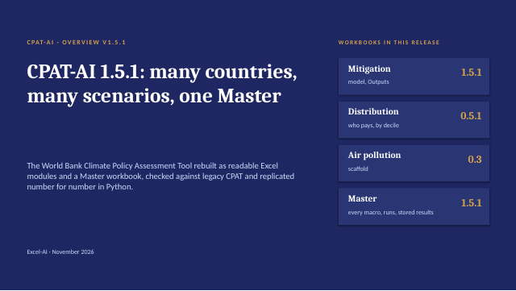
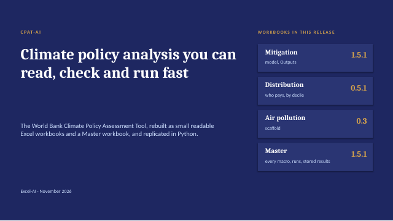

<!-- Generated by make_qmd.py from excel_ai/mitigation/docs/Documentation.md, excel_ai/mitigation/docs/methods/Macro_and_results.md, excel_ai/mitigation/docs/methods/Data_tabs.md: edit the sources, then run python make_qmd.py -->

# The mitigation module {#sec-mitigation}

```{=html}
<div class="decks">
<a class="deck-card" href="../presentations/earlier_versions/01_CPAT-AI_Overview_latest.pptx" style="display:flex;gap:14px;align-items:center;text-decoration:none;border:1px solid #dee2e6;border-radius:6px;padding:10px;margin:0 0 12px;max-width:640px;color:inherit"><span><b style="color:#2780e3">CPAT-AI overview: the mitigation prototype</b><br><span style="font-size:.9em;color:#6c757d">Status, how to run it, results (release 1.5) · PowerPoint, latest version</span></span></a>
<a class="deck-card" href="../presentations/earlier_versions/04_CPAT-AI_Pitch_latest.pptx" style="display:flex;gap:14px;align-items:center;text-decoration:none;border:1px solid #dee2e6;border-radius:6px;padding:10px;margin:0 0 12px;max-width:640px;color:inherit"><span><b style="color:#2780e3">CPAT-AI: the pitch</b><br><span style="font-size:.9em;color:#6c757d">Climate policy analysis you can read, check and run fast; 8 slides · PowerPoint, latest version</span></span></a>
</div>
```

::: {.callout-tip appearance="simple"}
The method of every block, with its equations and pseudocode, is in the **CPAT-AI Model** tab ([open it](../CPAT_model_documentation_html/index.html)), shared by Excel-AI and CPAT Python. This chapter is the workbook: how to open and use it, its sections, many scenarios, and its data tabs.
:::

*Source: [`excel_ai/mitigation/docs/Documentation.md`](https://github.com/cpmodelai/cpat_ai/blob/main/excel_ai/mitigation/docs/Documentation.md).*

*The guide to the mitigation workbook: what it is, how to run it, how it works section by section, its results and its limits. The method of every block, with its equations and pseudocode, is in the website's CPAT-AI Model tab; every legacy bug and issue is in the bug book and the tracker. This guide describes release 1.5 (Mitigation and Master 1.5.1, Distribution 0.5.1).*

## What it is

The mitigation module of the IMF/World Bank **Climate Policy Assessment Tool (CPAT)**, rebuilt as one readable Excel workbook for one country at a time.

It answers one question: **what do carbon pricing and related policies do to energy prices, energy use, emissions, government revenue, GDP and welfare, year by year to 2041?**

- **Policies in:** carbon tax, a new emissions trading system (ETS) with a cap, feebates, fuel excises, fuel subsidy and price-control reform, a methane fee, existing carbon pricing, power-sector policies, and road-vehicle policies (with the engineer road model).
- **Results out:** retail energy prices, fuel use in 16 sectors and 9 fuels, electricity generation, investment and prices, revenue, CO₂ and the other greenhouse gases, local air pollutants, GDP effects, the gap to the country's NDC, welfare, and the exports that the distribution and air-pollution modules read. Household effects by decile are the separate Distribution module.
- **One country, any country:** no formula contains a country's number or name. Every country value comes from the data tabs, looked up by the country chosen on tab Dashboard. The shipped data are complete for Egypt.
- **Same as legacy, minus its bugs:** it follows legacy CPAT except where legacy has a bug (fixed) or an open question (an issue, replicated and tracked). See section 6.
- **Readable and checked:** every formula is short (target 90 characters, at most 115), and one formula serves a whole block of cells. An independent Python recomputation (CPAT Python) checks the numbers.
- **Fast:** the workbook ships with its calculated values and formulas to 2035, so it opens quickly; repeated formulas are stored once as shared formulas; the Master saves the working copy as a binary `.xlsb`. Calculation is automatic.

## Quick start

The module workbooks have **no macros**. Every macro is in the **Master workbook**, `excel_ai/master/CPAT-AI-MT_latest.xlsm (the MT, Multiscenario Tool; activated as `excel_ai/active_workbooks/CPAT-AI-MT.xlsb`)`. The mitigation module ships as `excel_ai/mitigation/CPAT-AI-Mitigation_latest.xlsx` (every version in `excel_ai/mitigation/releases/`); the Master **activates** it into the workbook you work in, `excel_ai/active_workbooks/CPAT-AI-Mitigation_latest.xlsb`.

1. **Get the files.** Keep a clone of the repository up to date (git, or the SyncRepo script). The Master finds the modules in the clone, or else downloads them from GitHub.
2. **Open the Master** in Excel 365 and enable macros. If the file was downloaded, unblock it first (file Properties > Unblock). It opens on tab `Dashboard`, which has the three core macros: *Activate all*, *Run scenarios* and *Update data*. Every other macro is on tab `Activation and Macros`, one button each, with what it does.
3. **Activate all.** The Master opens each module's `.xlsx`, copies the 2035 column of every scenario group across to 2041, adds the live scenario groups (four by default: the baseline and three scenarios), writes its scenario table into the module, recalculates and saves `CPAT-AI-Mitigation_latest.xlsb` next to itself. Activate again whenever a new `.xlsx` arrives.
4. **Choose the countries and the scenarios** on the Master's `Dashboard`. Type one country per row in the Countries list and one scenario ID per row in the Scenario list (both grow downwards). The IDs are those of the Master's tab `Scenarios`: `BASE` the baseline, `P1`-`P5` the presets, `U1`, `U2`, ... your own scenarios. Every country listed runs every scenario listed. Choose the data source and the rows to load (one country or all) beside the buttons.
5. **Update data** if you run more than one country or need a fresher source: the Master loads the linked data tabs by Power Query, once for all countries.
6. **Run scenarios.** The Master runs every country with every scenario, in batches over the live scenario groups 2-4 of the mitigation workbook (the baseline once per country). An ETS scenario gets its goal seek, one per group. Each run is stored as values in tab `StoredResults`. *Estimate run time* (on the other tab) says how long a run will take.
7. **Read the results.**
   - **Live**, in the mitigation workbook: tab `Dashboard` (the country and the scenarios of groups 2-4, key numbers and charts with the four scenarios), tab `Scenario comparison` (the live scenarios side by side in a chosen year), tab `Outputs` (every live scenario group side by side, one output code per row) and tab `Diagnostic` (the country's baseline).
   - **Stored**, in the Master: `StoredResults` (one row per output per run), `Scenario comparison` (the key indicators of up to ten runs in a chosen year, against the first), `OneCountry` (one country, several scenarios, as time series) and `ManyCountries` (several countries, one scenario, one year).
8. **Look at one scenario live.** On the mitigation workbook's `Dashboard`, choose the country and the scenarios of groups 2-4 by name (group 1 is the baseline). To change a policy, edit its column on tab `Scenarios` (the rows of legacy MTInputs; for example `CPLevelTarget`, the carbon price in the target year). In the Master: *Send scenario to Mitigation* puts a Master scenario into group 2; *Get live scenario* adds group 2 to the Master's table as the next user scenario; *Sync scenarios to Mitigation* writes the whole table into the module.
9. **Distribution.** *Distribution from Mitigation* (other tab) copies the export block of the activated mitigation workbook (section 11a) into the activated distribution workbook, recalculates and saves it.

**Good practice.** The `.xlsb` files are generated: on a git conflict take either side and activate again; never merge them, and never commit Excel's `~$` lock files. A workbook run with real (non-public) data stays on your local drive.

## The workbook

The tabs, left to right:

| Tab or group | What it holds |
|---|---|
| `Dashboard` | The main view: the country and the scenarios of groups 2-4 (chosen by name; group 1 the baseline), the current situation (the baseline in a key year), the three policy scenarios against the baseline, eight key charts with the four scenarios, and the data that feed them below (rolled up) |
| `Scenario comparison` | The four live scenarios side by side in a chosen year: key results and their change against the baseline, four charts over time, emission reductions by sector and revenue gain by fuel |
| `Cover` | The settings of the live tool (the live scenario groups at activation, the scenarios of groups 3 and 4, the data transfer), the status written by the Master |
| `Scenarios` | Every scenario: one column each, the rows of legacy MTInputs exactly (row numbers and parameter names as legacy); row 2 short name, row 5 number, row 6 name, row 7 ID (`BASE`, `P1`-`P5`, `U1`, ...); drop-down lists of the options; the last columns are the Master's run columns |
| `Mitigation` | The model: numbered sections, top to bottom, one group of columns per scenario, years across (2022 to 2041) |
| `Outputs` | The key results of every scenario group, side by side, by output code, in Mitigation's row order within each topic; the revenue of every fuel |
| `Diagnostic` | The country's situation and baseline: headline numbers, then four charts each of the macroeconomy and public finances, emissions and targets, and the energy system; the data below (rolled up) |
| `Docs & Versions` | Version log, about this workbook, differences with legacy CPAT (with their register codes), the variable dictionary and the LAMBDAs |
| `INPUTS->>` | `Manual inputs` (the legacy tab of that name, at the legacy addresses), `Settings` (workbook-wide settings and constants: name, value, unit, description, source, by area of the model), `Mappings` (sectors, fuels, policy keys, MTInputs rows, and the data step: every lookup of the data tabs) |
| `OTHER MODULES->>` | `FromAP` and `FromTrans`: what Mitigation reads from the air-pollution and transport co-benefits modules, by country (row 1 says whether the country has rows) |
| `DATA_MITIGATION->>`, `DATA_TRAN->>` | The data tabs, in the legacy layout; the linked ones are refreshed by the Master (Power Query) |

Colours: lemon cells with bold black text are the inputs of `Dashboard` and `Cover`; blue bands mark the export sections (what other modules read); pale orange marks data that differ from the source by a decision of the team.

## How it works

The `Mitigation` tab runs top to bottom, one section per step, numbered 1 to 19 in sheet order. Each section starts with a band (its number and title), ends with a summary row (the only row shown when the sheet is rolled up) and has sub-blocks with headings. Every row carries a code in columns A:C (variable, fuel, sector); its label, unit and source come from the variable dictionary.

Each scenario is a group of columns: group 1 the baseline (scenario 1), group 2 the Dashboard's policy scenario, groups 3 and 4 two more scenarios (added at activation; the Master's runs use groups 2-4). Inputs that are the same for every scenario (the results year, some power and data settings) are read from scenario 1's column and checked on `Settings`.

| Section | Step | Method (CPAT-AI Model chapter) |
|---|---|---|
| 1 | Scenario assumptions: scenario name and number, inflation, real GDP and its growth after the GDP feedback | Overview |
| 2 | Policies: the price signal of each policy, year by year | Prices |
| 3 | Retail energy prices, by fuel and sector, before and after policies; average prices and price indices | Prices |
| 4 | Power sector: demand, dispatch, capacity, investment, costs, electricity prices, power revenues | Power |
| 5 | Road transport: the engineer model (its outputs to transport co-benefits: export block 11b) | Road transport |
| 6 | Transport sector: fuel use of road, rail, aviation and navigation | Energy demand; Road transport |
| 7 | Buildings sector: residential (with its leakage block: the most-used cooking fuel to biomass), services | Energy demand |
| 8 | Industrial sector: the industry subsectors | Energy demand |
| 9 | Other energy use: the remaining subsectors (for example food and forestry) | Energy demand |
| 10 | Energy consumption: totals by fuel and sector; 10b the change against scenario 1 | Energy demand |
| 11 | Export to other modules: 11a the rows the distribution module reads (`ExportDistn`), 11b the transport co-benefits block | Distribution |
| 12 | Revenues: existing taxes and subsidies, new policies, methane fee; 12d fiscal reports, 12e total revenue by policy | Revenues, GDP and welfare |
| 13 | Emissions: CO₂ from fuel combustion, calibrated to the inventory; 13b change, grid intensity, Kaya identity | Emissions and ETS |
| 14 | GHG emissions: methane, nitrous oxide, F-gases, other inventory categories; 14b change; 14c NDC | Emissions and ETS |
| 15 | Local air pollutants: EXPORT to the air pollution module | Emissions and ETS |
| 16 | GDP effects and external balance: fiscal multipliers; 16b energy trade balance | Revenues, GDP and welfare |
| 17 | Carbon pricing: prices, coverage, effective carbon rate, the new ETS against its cap | Emissions and ETS |
| 18 | Inputs from air pollution and transport co-benefits: the damages per unit of fuel read from `FromAP` and `FromTrans` | Revenues, GDP and welfare |
| 19 | Welfare and externalities: climate damages, efficiency costs, co-benefits, efficient prices and their cost components | Revenues, GDP and welfare |

The method of each block, with its equations and pseudocode, is in the website's **CPAT-AI Model** tab (<https://cpmodelai.github.io/docs/#model>; sources `docs/CPAT_model_documentation_qmd/`), shared with CPAT Python. The notes in `excel_ai/mitigation/docs/methods/` are the workbook-side detail: rows, names and checks.

### Policies (section 2)

Each policy is a path from a start year to a target year, set per scenario on `Scenarios`. The carbon price follows that path:

```
τ(t) = path(t; start year, target year, start level, target level) · (CPI index if the inputs are nominal)
```

A new ETS starts at a price estimate and is checked against its cap; the Master's goal seek refines it. Feebates act through a shadow price, which changes efficiency but raises no revenue. Existing carbon taxes and ETS prices come from the World Bank Carbon Pricing Dashboard data. Where the chosen main scenario is a regulation, the carbon price path becomes a shadow price on the efficiency margin.

### Energy prices (section 3)

For each fuel and sector, the retail price builds up from the international price:

```
supply cost  C(t) = fixed part + (C(t−1) − fixed part) · international price(t) / international price(t−1)
retail price R    = (C + excise and other taxes) · (1 + VAT)
after policy P    = R + new carbon tax + ETS price + new excise, each with VAT
```

Subsidies are negative taxes; subsidy and price-control phase-outs add a wedge. Historical prices come from the price data up to the last historical year; later years are projected. A memo at the end of the section gives average prices and price indices.

### Power (section 4)

Electricity demand comes from the sectors. The power model, as legacy's engineer model, decides each year:

- **Dispatch:** which plants run, by their variable cost (fuel, carbon price, operation).
- **Investment:** new capacity by technology, chosen by levelised cost with a logit share, within scale-up limits.
- **Prices:** electricity prices from the cost of generation, with taxes, subsidies and price controls.

Power-sector policies (no new coal, nuclear from a year, renewable subsidies, power purchase agreements, rebating revenue, an electricity excise) are set per scenario.

### Energy demand (sections 5 to 10)

Fuel use in each sector changes each year with income, its own price and efficiency:

```
Q(t) = Q(t−1) · (efficiency gain) · (1 + GDP growth)^(income elasticity) · (P(t)/P(t−1))^(price elasticity) · (efficiency response to prices)
```

The elasticities are legacy CPAT's. By default road fuel use follows these elasticities as every other sector. With `TrModel` = Engineer, the road engineer model of section 5 replaces it: vehicle stocks by class, cost of ownership, the choice between combustion and electric vehicles, and vehicle policies (feebates, EV subsidies, purchase taxes, distance tax). Section 5 is computed in every scenario either way, so the two approaches can be compared. In the buildings section, a block moves part of the most-used cooking fuel to biomass when its price rises (leakage). Section 10 adds up fuel use by sector and fuel, including the fuel burnt in power plants.

### Exports to the other modules (sections 11 and 15)

Sections with a blue band hold what other modules read, by code. Section 11 comes right after energy consumption: block 11a (defined name `ExportDistn`) is the input of the Distribution module (household effects by decile in one analysis year). The Master copies it into the distribution workbook (*Distribution from Mitigation*). Block 11b holds the outputs of the road model (section 5) for the transport co-benefits module. Section 15, the local air pollutants, is what the air-pollution module will read.

### Revenues (section 12)

Revenue is fuel use times the tax per unit, by fuel and sector, for existing taxes, existing subsidies (negative) and new policies:

```
revenue from new policies = fuel use · (carbon tax + excise + auctioned share · ETS price + VAT on them)
total revenue             = existing taxes + subsidies + new policies + methane fee
```

The power sector adds its own revenue and subsidies. Feebates are revenue neutral.

### Emissions (sections 13 to 15)

```
CO₂ = fuel use · emission factor        (factors calibrated to the GHG inventory where the switch is on)
```

The other greenhouse gases (methane, nitrous oxide, F-gases) follow their drivers; methane from fuel supply responds to the methane fee. The NDC block compares the scenario with the country's chosen NDC target. Local air pollutants (fine particles, sulphur and nitrogen oxides and others) are fuel use times pollutant factors.

### GDP, carbon pricing, welfare (sections 16 to 19)

New revenue is fiscal space. How it is used (tax cuts, investment, transfers) moves GDP through fiscal multipliers, from the following year:

```
fiscal space fs(t)  = (new revenue in the scenario − in the baseline) / GDP
GDP effect          = Σ over uses: share of the use · Σ over lags (change in fs · multiplier of the use)
```

The GDP effect feeds back into GDP growth (section 1), which drives fuel use. Section 17 reports carbon prices, coverage and the effective carbon rate. Section 18 reads the damages per unit of fuel from the air-pollution and transport co-benefits modules; section 19 values the climate damages avoided, the efficiency costs and the co-benefits, and gives the efficient prices with their cost components.

## Results

**Outputs** shows the key results of every scenario group side by side, in the columns of the scenario groups of `Mitigation` (row 5: the scenario number of each group). It lists only what the prototype computes, by topic in the order of Mitigation's sections, and within a topic in Mitigation's row order: policies, energy prices, power, energy use, revenue and fiscal, emissions and NDC, air pollution, macroeconomy, efficient prices and their cost components, welfare and externalities.

**Output codes.** Each row carries a code built from its parts, `<module>.<variable>.<sector>.<fuel>[.<suffix>]` (columns B and D:G). The full code adds the country in front and the scenario number at the end: for example `egy.mit.co2.tot.tot.2` is Egypt's total CO₂ from fuel combustion in scenario 2. The cost components of the efficient prices are coded `cost.<sector>.<fuel>.<component>`. The names come from the same dictionary as Mitigation's labels. The codes are those of CPAT Python; the codes map `excel_ai/core/CPAT-AI_CodesMap_v<version>.xlsx` lists the code protocol, the vocabularies, the variables, the output codes and every input (its MTInputs row, its name and its Python key).

**Dashboard and Diagnostic** show the key numbers and charts of the live scenarios, read from `Outputs` by code. Some of their panels still hold dummy data (pale orange) until the data or the other modules deliver them.

**Stored results** are in the Master: `StoredResults` (values, one row per output per run, keyed by country, scenario ID and code; tab `Indicators` chooses which rows a run stores), `Scenario comparison`, `OneCountry` and `ManyCountries` (tables and charts read from `StoredResults`). *Save results to .csv* writes `StoredResults` to a file. Details: *Running many scenarios*.

## Limits and differences from legacy

The rule: **never replicate a legacy bug; always replicate a legacy issue, and track it.** A **bug** is legacy computing what it does not intend; the prototype fixes it. An **issue** is legacy doing what it means to, where the choice is open to question; the prototype does the same. Problems of the input data are issues too: where legacy reads the data wrongly, the formula fix is a bug with a cell plan and the issue is Very high; where no cell plan is possible, the prototype does exactly what legacy does and the issue is Extremely high.

| Code | Kind |
|---|---|
| L | Legacy bug: fixed in the prototype, with a cell-level fix plan for legacy |
| M | Prototype bug: fixed and recorded |
| DOC | Error in the CPAT methodology documentation: corrected in its chapter *Corrections* |
| MId | Major issue, data (MId1-MId5): the most important data problems |
| MIm | Major issue, methodology (MIm1-MIm5): the most important open questions of method |
| I | Issue: replicated and tracked |
| LD | Departure from legacy decided by the team (listed on `Docs & Versions`) |
| U | Upgrade beyond legacy |

The ten major issues keep their former issue codes in the register. The bugs, with the cell-level fix for legacy CPAT and the status of each in the latest legacy file `CPAT 1.0pre_465`, are in the bug book `excel_ai/bugs_and_legacy/Legacy_CPAT_Bugs_v<version>.docx`; the master list of bugs and issues is the tracker `excel_ai/bugs_and_legacy/Tracking_Legacy_Bugs_v<version>.xlsx`; the short lists are `excel_ai/core/BUGS.md` and `excel_ai/core/ISSUES.md`.

**Limits.**

- **Data:** the shipped data are Egypt's, with the six proprietary tables perturbed (data edition Public01). Other countries need their data loaded through the Master (issue MId1).
- **Other modules:** the air-pollution and transport co-benefits values on `FromAP` and `FromTrans` are typed for Egypt only, until those modules write them. The distribution module runs one scenario at a time. Achieve NDCs and the ETS goal seek of the Master's runs await the team's test in Excel.
- **Settings and policies:** some inputs on `Scenarios` are read from scenario 1 for every scenario (a check on `Settings` shows them); model settings and policy inputs are not yet separated.
- **Legacy row numbers** in the method notes are rows of `CPAT 1.0pre_456_NoPropData.xlsb`, the file the prototype was built against; in `CPAT 1.0pre_465` the Mitigation rows from 5667 on sit 11 to 15 rows higher. The input tab `Scenarios` has the rows of the 465 MTInputs.
- **Not built:** a few legacy features (upgrades U), the air-pollution calculations and the transport co-benefits module.

**Next steps.** A user interface (the specification is in `excel_ai/bugs_and_legacy/ui_spec/`: a mock-up and the core graphs of country reports); model settings split from policy inputs; the other modules (distribution started, air pollution, transport co-benefits); the full set of core graphs in the Master; the real data behind the dummy panels of `Dashboard` and `Diagnostic`.

## Running many scenarios {#sec-many-scenarios}

*Source: [`excel_ai/mitigation/docs/methods/Macro_and_results.md`](https://github.com/cpmodelai/cpat_ai/blob/main/excel_ai/mitigation/docs/methods/Macro_and_results.md).*

Equations: `Equations.md`; workbook formulas: `Formulas.md`.

The mitigation workbook calculates four scenarios at a time, one group of columns each: group 1 is the baseline (scenario 1), group 2 the policy scenario chosen by name on tab Dashboard, groups 3 and 4 two more scenarios (added by the Master at activation). The macros and the stored results are in the **Master workbook** (`excel_ai/master/CPAT-AI-MT_latest.xlsm (the MT, Multiscenario Tool; activated as `excel_ai/active_workbooks/CPAT-AI-MT.xlsb`)`); the module workbooks have no macros. The Master's run sends the scenarios to the live groups 2-4 in batches, lets the workbook calculate and stores the results as values, which are compared afterwards. This follows the legacy Multiscenario Tool, where every country listed runs every scenario listed and the outputs are stored.

### Where things are

| Place | What it holds |
|---|---|
| Dashboard (mitigation workbook) | The country and the **policy scenario** of Mitigation group 2, chosen by its name from tab Scenarios (`PolicyName`; its number `PolicyScen`); key numbers and charts of the live scenarios. |
| Cover (mitigation workbook) | The live scenario groups at activation (`LiveGroups`, 2, 3 or 4; default 4), the scenarios of groups 3 and 4 by name (`DashG3`, `DashG4`), the data transfer choices, the status written by the Master. |
| Scenarios, column G | Scenario 1, the **baseline** (ID `BASE`). |
| Scenarios, columns H onwards | One column per **scenario definition**: short name (row 2, the legend in the charts), number (row 5), name (row 6), ID (row 7: `P1`-`P5` the presets, `U1`, `U2`, ... user scenarios), then the inputs, in the rows of legacy MTInputs. The last three columns (AX-AZ) are the Master's run columns: a batch writes its scenarios there. |
| Mitigation | Scenario groups side by side: group 1 the baseline, group 2 the policy scenario of the Dashboard, groups 3 and 4 further scenarios; group *n* calculates the scenario number in its row 5. |
| Outputs | The key results of every scenario group **side by side**, in the columns of Mitigation's groups: only what the prototype computes, by topic in the order of Mitigation's sections and, within a topic, in Mitigation's row order (the revenue of every fuel included); columns A:J the output code (`variable.sector.fuel.suffix`, built from the parts in D:G), module, legacy MTOutputs code(s), indicator, unit and Mitigation row; row 5 the scenario number of each group. Each cell is Mitigation's cell of its code in the same column. |
| Master: Dashboard | The core macros (Activate all, Run scenarios, Update data), the data source and the rows to load, the Countries and Scenario lists (from row 18, growing downwards), the scenario shown with its key inputs, the run status. |
| Master: Scenarios | The master copy of the scenario table (the module's rows, the IDs in row 7). Activation and *Sync scenarios* write it into the module by ID and `NameOfParameter`. |
| Master: Indicators | The rows of Outputs and whether a run stores them (Include = Yes / No). |
| Master: StoredResults | Results as **values only**, vertical as the legacy MTOutputs: one row per output per run, keyed by country code, scenario ID and code stem, with when, from which version and which data source it was stored; an index of the stored runs on the right. |
| Master: Scenario comparison, OneCountry, ManyCountries | Tables and charts read from StoredResults by key: up to ten runs in a chosen year against the first; one country's scenarios as time series; several countries' runs of one scenario in one year, against each country's `BASE`. |
| Master: VBA module CPATMaster | Every macro (source `excel_ai/master/CPATMaster.bas`). |

### Shipped definitions

| No. (ID) | Short label | Name | Inputs changed from the template |
|---|---|---|---|
| 1 (BASE) | Baseline | Baseline (no carbon price) | None |
| 2 (P1) | Carbon tax \$20 | Carbon price \$20/tCO2 from 2027 | The template's policy scenario |
| 3 (P2) | Tax to \$50 + feebates | Package A: carbon tax to \$50 by 2030 + feebates (transport, industry) | Carbon tax \$10 (2027) to \$50 (2030). Feebates 2027-2030: transport \$10 → \$50, industry \$5 → \$25. Feebate coverage adds road, mining & chemicals, and iron & steel |
| 4 (P3) | Carbon tax \$50 | Carbon price \$50/tCO2 from 2027 | The carbon price of definition 2 at \$50 |
| 5 (P4), the Master's table only | ETS power + industry | Package B: ETS on power and industry + carbon tax \$25 elsewhere | Carbon tax \$25 from 2027. New ETS from 2027: cap −5% (2027) to −20% (2035) of baseline covered emissions, constant afterwards. Template ETS coverage (power, mining & chemicals, iron & steel, non-ferrous metals, cement), default benchmarks and volatility. Not in the module's defaults, Dashboard or decks; the Master's ETS goal-seek test runs it |

The short label (tab `Scenarios` row 2; at most 28 characters, unique, checked in row 4) names a scenario in the pickers, chart legends and tables; the full name shows on a grey line under each Dashboard picker and Scenario comparison header.

Paths continue after their target year as set in the model: the carbon price follows its Scenarios switch, and feebates are held at their target rate (as legacy; L174 fixed).

### Main scenario choice and regulations as shadow prices (LD9)

Scenarios row 13 (`ScenarioSelected`, " - Carbon tax" in every shipped scenario) picks a row of the legacy scenario table (legacy Mitigation rows 222-262, columns N:AC; sheet Mapping, block "Main scenarios"): whether the scenario prices carbon explicitly (legacy row 259), its efficiency adjustment (Scenarios rows 247-251) and the sectors its shadow price covers (rows 240-257).

- Explicit scenarios (carbon tax, total carbon price, coal excise, road fuel tax, electricity emissions tax and excise): the carbon price path of Scenarios rows 18-21 is the carbon tax (`cpx` = `cptraj`), as before.
- Shadow-pricing scenarios (feebates, power supply feebates, energy efficiency regulations, power feebate, vehicle fuel economy, residential and industrial efficiency regulations; and "Baseline"): no explicit carbon tax (`cpx` = 0); the carbon price path becomes a shadow price on the efficiency margin, `reg.<sector>` = `cp.shd` x the scenario's adjustment (energy efficiency 247, vehicle fuel economy 248, residential 249, industrial 250, feebates 251; Egypt 0.7, feebates 1) x 1 if the scenario covers the sector. It enters `shpx` (with the feebate part, now x row 251, and the ETS benchmark part), so fuel use responds through efficiency only, and power through `shk` (legacy bugs L87, L88 fixed: legacy's regulation share is 0 and never reaches power).
- The road vehicle feebate of the engineer road model adds `reg.rod` (the road regulation shadow price) instead of the carbon price, which is in the fuel price already (prototype bug M13).
- A text that is not in the table counts as explicit pricing (as the shipped " - Carbon tax").

### Macros (in the Master)

Run scenarios is the button of the MT's (the Master's) tab `Dashboard`; Activate all and Update data, with their settings, and every other macro have one button each, with what it does, on tab `Activation and Macros` (1.9.5) (also Alt+F8). Calculation is automatic in the modules and is switched back on after every macro, even one that stops.

- **Activate all** (or Mitigation, Distribution or Air pollution only): opens the module's latest `.xlsx` (the local repository copy, else its GitHub link), copies the 2035 column of every scenario group across to 2041 (Mitigation and Outputs), adds the live groups 3 and 4 (as `LiveGroups` says), writes the Master's scenario table into tab Scenarios, recalculates and saves `<Name>_latest.xlsb` in `excel_ai/active_workbooks/`. The workbook stays open.
- **Update data**: refreshes the linked data tabs of the activated mitigation workbook by Power Query, from the source and the rows chosen on the Master's Dashboard (the module's Cover can override), and saves the workbook.
- **Run scenarios**: every country of the Dashboard's list with every scenario of its list. Countries without data are reported before the run starts. Per country: the country is set, the baseline (the Master's `BASE`) is stored once, and the other scenarios are sent by `NameOfParameter` to the run columns in batches of three, one per live group 2-4, with one recalculation per batch. A batch with an ETS scenario runs the goal seek on every such group at once. Each run is stored in StoredResults (the rows with Include = Yes). The Dashboard shows the progress and the measured run time; at the end the module's dashboard, scenario 1, the ETS overrides and the calculation mode are restored, and the results are written to a .csv when the Dashboard says Yes.
- **Estimate run time**: times one full recalculation and estimates the run of the Dashboard's lists.
- **Store live scenarios**: stores every live group of Outputs in StoredResults, under the module's country and the scenario IDs of its tab Scenarios.
- **Sync scenarios to Mitigation**, **Send scenario to Mitigation**, **Get live scenario**: write the Master's scenario table into the module; send the scenario shown on the Dashboard into group 2; add group 2's scenario to the Master's table as the next user scenario.
- **Goal-seek ETS price (live)** and **Achieve NDCs (live)**: the ETS price path that meets the cap of group 2's scenario; the carbon tax of group 2's scenario scaled until GHG emissions meet the NDC target in the target year.
- **Distribution from Mitigation**: copies the export block of Mitigation (section 11a, defined name `ExportDistn`) into `FromMitigation` of the activated distribution workbook, by code (it stops if the rows do not match), recalculates and saves it.
- **Clear results**, **Save results to .csv**, **Indicators: include all / key only**: empty StoredResults (after a confirmation); write it to a file; choose the rows a run stores.

The ETS goal seek is legacy's damped log-space iteration, as in `ets_goalseek.py`. It starts from the override prices, or from the fast estimate if there are none. Each step is p × (proposed price / p) ^ alpha, mixed 0.3 with the previous iterate, with 5% smoothing. Alpha halves when the error grows (minimum 0.0625) and rises ×1.2 when the error more than halves (maximum 1). It stops when the worst |covered / cap − 1| is below 0.5%, or after 20 iterations.

### Comparing and keeping results

- **Live** (in the mitigation workbook): Outputs holds the four scenario groups side by side; the Dashboard and the Diagnostic chart them.
- **Stored** (in the Master): StoredResults keeps every run as values, so runs of many countries and scenarios sit together. Scenario comparison compares up to ten stored runs in a chosen year with the first (level, difference and % difference, the last for strictly positive levels only) with a column chart; OneCountry shows one country's scenarios as time series; ManyCountries shows several countries' runs of one scenario in one year, against each country's baseline.

### Limits

- Four live groups: a run of more scenarios goes in batches of three, each batch a recalculation.
- Outputs defines what can be stored: its rows, each code once. To store more, add rows to Outputs (in the builder).
- Many countries need every country's data loaded once first (Update data, all countries).
- The runs and the ETS goal seek of a run are checked in LibreOffice; Achieve NDCs is not yet tested; the team's test in Excel is open.

## The data tabs {#sec-data-tabs}

*Source: [`excel_ai/mitigation/docs/methods/Data_tabs.md`](https://github.com/cpmodelai/cpat_ai/blob/main/excel_ai/mitigation/docs/methods/Data_tabs.md).*

User request (2026-10-17): align the data tabs with legacy CPAT (grouped by module, legacy order, legacy names and
content where possible, without undoing principled decisions); check that the model would work with the full
all-country data; put every Egypt-only table alone on its tab or at the bottom; check how far the legacy data tables
can be copied in. Then (same day): align more fully, going with the recommendations. The norm is NORMS.md 1.5.

### Summary

- **Order.** The data tabs sit under the legacy dividers in legacy order: `DATA_MITIGATION->>` (the tables derived for Mitigation last:
  CookingFuel, Multipliers, BaselineCO2; 1.2.2), `DATA_DISTN->>` (the distribution workbook), `DATA_TRAN->>`.
- **Copy-in rules (NORMS 1.5).**
  - **L, a single legacy table:** the table itself, unchanged (same columns, column letters and codes; header row 3,
    data from A4; a key formula column right of the table where legacy has no unique key). Paste the legacy data rows
    at A4. 17 tabs: Balances, EnergyCons, CH4Inputs, UNPop, OilProductShares (v0.4.12), WEO, EF_GHG, SCC, EF_PM,
    IO_GTAP, HHSurvey, HH_Elast, ASPIRE, WHOCooking, GDPRatios, Transport1, Transport2.
  - **A, a legacy tab with several tables:** kept at its legacy cell addresses from row 3 (rows 1-2: source line and
    title bar). Paste the legacy tab from row 3. 10 tabs: Countries, Elasticities, ETS+LTS, Multipliers, Prices_int,
    ECP, Transport3 (stored results, rows 5+) and, since v0.4.7, Power, CoC and GHGs (the inventory and, rows
    1201-1388, the 2023-2024 emission shocks of the power model).
  - **L*, Prices_dom:** legacy header rows and codes; paste legacy rows 4 onwards at A1.
- **Country selection is a data step (NORMS 1.5, rule 2c).** What legacy Mitigation computes from these tabs for the
  selected country sits in blocks of the Inputs tab, by formula, under the keys the model already used:
  - Inputs_ela: elasticities (the country's column of Elasticities, as legacy column G);
  - Inputs_mult: multipliers (median ± standard deviation by group, instrument and lag);
  - Inputs_macro: GDP growth and levels, deflators, exchange rate (WEO series with legacy's extension past the last data
    year, rows 417-467) and the energy trade balance and share traded (rows 741-743, from Balances);
  - Inputs_pint: international price series by source (rows 633-695);
  - Inputs_ecp: existing carbon pricing (rows 1675-1764; v0.4.12: carbon tax with single and fuel rates, national ETS and
    EU ETS, each code looked up in its own legacy block of ECP, coverage by data year, and two tables by ECP sector and
    fuel: carbon tax and ETS in \$/tCO2);
  - Inputs_ef: CO2 emission factors (rows 980-1011);
  - Inputs_nc (v0.9.0): non-CO2 combustion emission factors of local pollutants and CH4 by legacy EF code (rows
    1052-1663: country, else World Bank region, else world, from the all-country EF_PM; other energy the maximum
    across the other subsectors);
  - v0.4.7, power (legacy section 4, rows 2954-4300): Inputs_pset (the power settings of Scenarios scenario 1 and derived
    values, each a defined name Ps...), Inputs_ptech (one row per generation type, the former PowerTech: country, else
    world parameters, efficiency and generation from Balances, WACC from CoC, capacity factors), Inputs_ppath (year
    paths, the former PowerPaths: capex time factors, storage, income factor, fuel price shocks, prices) and
    Inputs_ppar (parameters, the former PowerParams). The chains are mapped in chapter Power.
  The Egypt values reproduce legacy's cached values (macro series to 1e-15; power data to 1e-12), apart from one legacy
  bug fixed (L51: the coal trade balance was valued at the oil price) and one stale value in legacy's stored run (I38:
  the wind and solar capex time factors for 2039-2041 differ from the legacy Power cells they reference; the prototype
  follows the Power tab).
- **Proprietary tables.** The public legacy file (`CPAT 1.0pre_456_NoPropData.xlsb`) holds Egypt only in Balances,
  EnergyCons (empty), Prices_dom, EF_PM, IO_GTAP, HHSurvey, ASPIRE, WHOCooking, CalVal and Tran_Scatter. The model
  uses the first eight; all eight paste in directly.
- **All-country test: PASS.** `check_allcountry.py` clones every Egypt row of every single-table tab under a dummy
  country (XEG) at the bottom of its table, renames Egypt's codes to XEG in place on the tabs kept at legacy addresses,
  selects XEG and recalculates: no error values, every output of Mitigation and Distribution identical to Egypt's.
- **No table from legacy's cached Egypt run is left (v0.4.7).** The former PowerTech, PowerPaths and PowerParams are
  computed from the legacy tabs on Inputs. BaselineCO2 (the scenario-1 CO2 the calibration uses) is derived by the
  build.
- **Legacy bugs in the power data: all fixed (v0.4.10, NORMS 0; v0.4.7 still copied them):** L52 every generation type
  takes the country parameters where they exist (Egypt: solar fixed O&M 11.831 instead of 15 \$/kW/y); L53 the actual
  capacity factor of the base year (installed capacity, Power rows 358-1635) is used inside the CFOverride bounds (Egypt:
  gas 0.385, wind 0.436, solar 0.347, hydro 0.592; base-year gas capacity 52 GW instead of 35); L54 hydro invests from
  the base year only when its generation share is above 50% (Egypt: from 2030); L55 the country rows are looked up in
  the country block first (China, Japan, Korea); L56 countries without CoC risk data take the default WACC, flagged.
- Balances, EnergyCons, EF_PM, IO_GTAP, HHSurvey, HH_Elast, ASPIRE, WHOCooking and GDPRatios became legacy tables
  (v0.4.5). Then GHGs, CH4Inputs, UNPop, EF_GHG, SCC, Transport1 and Transport2 followed. The tables come
  from `extract_legacy_tables.py`, which writes `legacy_<Tab>.csv` verbatim from the legacy file (today into the legacy-form cache
  `.buildcache/legacy_csv/<edition>/`, saved to `data/<edition>/tidy/` by `data/scripts/legacy_csv.py`).
- Base-year fuel use and power demand now come from Balances through legacy's flow mapping (Mapping columns J-M), as
  legacy does with BalancesOrConsumption = Balances; the old PowerDemand tab was dropped.
- CO2 emission factors: the legacy EF_GHG table replaces the Egypt factors copied from legacy's run. The selection of
  legacy Mitigation rows 980-1011 is now a data step on Inputs, and it reproduces the Egypt factors exactly:
  - the country's code, else its World Bank region, else the world;
  - LPG and kerosene in power, and coal, LPG, kerosene and other oil products in road, take the row legacy points to;
  - jet fuel uses the IEA factor (EFJetIEA);
  - biomass is zero.
- GHGs: the legacy table adds Zimbabwe 2021 (legacy row 947). The previous extract stopped at row 946.
- All named ranges over data tables reach the capacity of the full legacy tables, with margin.
- v0.4.6: Countries, Elasticities, ETS+LTS, Multipliers, Prices_int, ECP and Transport3 became legacy tabs at legacy
  addresses (`legacy_<Tab>_cells.csv` in the legacy-form cache), WEO the legacy table; the selections legacy makes for the country became
  the Inputs blocks above; the GHG inventory year and every other lookup are unchanged.
- v0.4.6 results against v0.4.5: unchanged except the coal trade balance (L51 fixed; external balance rows xtb, about
  0.6 bn USD a year for Egypt) and the base-year lagged GDP growth of the road model (trgdl, 2022: the WEO 2021 growth
  3.25 % instead of 0, transport bug B2 now fixed, as the builder intended; the old WEO copy had no 2021 growth).
- v0.4.7: Power, CoC and GHGs became legacy tabs at legacy addresses; the power data of the country (the former tabs
  PowerTech, PowerPaths and PowerParams, copied from legacy's Egypt run) became the Inputs power blocks, formulas only
  (country, else world parameters; efficiency and generation from Balances; WACC from CoC; capex time factors, storage,
  income factor, emission shocks; settings from Scenarios scenario 1). The values reproduce the former tables, except
  the wind and solar capex time factors for 2039-2041 (I94). Effect on Egypt's results: none before 2039; from 2039
  new capacity and investment of solar, wind and gas, then power fuel use and emissions (525 output codes; largest:
  new solar investment in the baseline, by up to 149 MW a year).
- Dropped in v0.4.7: PowerTech, PowerPaths, PowerParams (now Inputs blocks from Power, CoC, Balances, WEO, GHGs).
- v0.4.12: OilProductShares (legacy table, all countries; household share of diesel, kerosene, LPG and gasoline, and
  their road shares) after UNPop, as legacy. Inputs_prices multiplies the VAT rate of gasoline, diesel, LPG and
  kerosene by the household share, as legacy rows 797-816 (LD5, issue I39). Settings rows 46-51: the methane fee
  switches per source of legacy Manual inputs J196-J200 (LD46; since v0.5.2 on sheet Manual inputs, shown on Settings). Inputs columns efxs:eff (v0.9.0: removed, legacy 465 factors; nearest GAINS factors, bug
  L59) and ecpk, xcp0 (existing carbon pricing), which replace ctc and etc.

### Manual inputs: the second input source, at the legacy addresses

Sheet `Manual inputs` (tab group INPUTS->>, after Scenarios) is the whole legacy tab of that name, rows 3-378 at their
legacy cell addresses (rows 1-2: source line and title bar), so the legacy tab pasted from row 3 replaces it. The cells
come from `legacy_ManualInputs_cells.csv` in the legacy-form cache (`extract_legacy_tables.py manual`): legacy values typed, light
green on the input cells. Legacy formulas within the sheet are kept (unit labels, the SCC path, the memo rows, the
residual of the PM2.5 apportionment); formulas that read other legacy tabs are replaced by the prototype equivalent (country
name and code, Scenarios scenario 1, the Elasticities tab) or typed as their legacy default value, and the note on the
block's title row (column J) says which. Scenarios stays the main input sheet (NORMS 4).

| Rows | Block | Read by the prototype |
|---|---|---|
| 5-15 | ETS: advanced parameters, sector inclusion, override price | E10:E12, the goal-seek settings (names ETSMaxIterations, ETSStartFreshContinue, ETSErrorTolerance; prototype values 20, Continue, 0.005; legacy 30, Continue, 0.001): macro SolveETS and `ets_goalseek.py`. Not read: E7:E9, the inclusion rows and the override row, which the prototype holds per scenario (Scenarios rows 95-97, 99-115; row ets.ovr of each scenario group) |
| 18-47 | Process emissions (CBAM goods): coverage, emission factors, half elasticities | No: feature not built |
| 49-54 | Feebates: sector flags | No: Scenarios rows 66-82 per scenario |
| 57-146 | Domestic energy prices and taxes (manual) | No: feature not built (prices: Prices_dom) |
| 148-163 | Excise reform (additional excise) | No: feature not built |
| 165-180 | Domestic energy price controls | J167:J180 by code (names PCtrlKey, PCtrlVal): Inputs_prices column pcm, the pass-through when GovPriceControls = Manual (blank = 1, as legacy); electricity rows not read |
| 183-200 | Methane fee | J196:J200, the fee scope by source (names MFeeBio, MFeeDG, MFeeFF, MFeeAgr, MFeeWst; shown on Settings rows 47-51). Not read: J185:J194 (not built) |
| 202-215 | Imperfect pass-through (Distribution) | No: not built (legacy does not wire it either) |
| 218-225 | International energy price forecasts (manual) | J221:AF225 by label and year (names PIntManVal, PIntManLab, PIntManYear): Inputs_pint rows Manual from 2026, when IntEnerPricForeSource = Manual |
| 228-231 | GDP forecasts (manual) | No: feature not built |
| 234-240 | Social cost of carbon | Yes since v0.5.2: row 237 is the Manual option of NSCCSource / GSCCSource (legacy bug L103: legacy reads the path typed on Mitigation row 17683 and leaves this block dead) |
| 243-254 | PM2.5 source apportionment | No: feature not built |
| 257-269 | Fiscal multipliers | J261:U268 (names MultMan, MultManKey): Inputs_mult, when MultipliersSource = Manual |
| 271-327 | Elasticities and efficiency improvements | K326:M327, the non-energy GHG elasticities (names GhgElCat, GhgElPop, GhgElInc): section 14 rows ghg.dr and ch4.act. Not read: the manual energy elasticities (not built) |
| 330-340 | Additional mitigation effort (non-energy) | No: feature not built |
| 342-372 | New investments in power (manual capacity) | No: built later with the power features |
| 373-378 | Transport: fuel economy of new EVs | J375:AC377 by label (D375:D377) and year (names BEVFEVal, BEVFELab, BEVFEYr): section 5 rows trfen |
