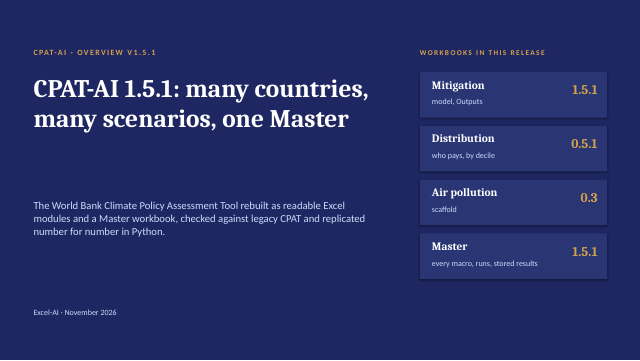
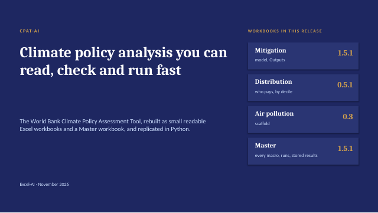
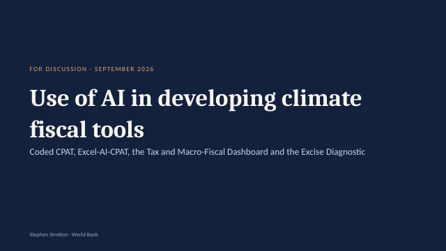

# CPAT Excel-AI {.unnumbered #book-home}

<style>#book-home > h1 { display: none; }</style>

```{=html}
<div class="decks">
<a class="deck-card" href="../presentations/earlier_versions/01_CPAT-AI_Overview_latest.pptx" style="display:flex;gap:14px;align-items:center;text-decoration:none;border:1px solid #dee2e6;border-radius:6px;padding:10px;margin:0 0 12px;max-width:640px;color:inherit"><span><b style="color:#2780e3">CPAT-AI overview: the mitigation prototype</b><br><span style="font-size:.9em;color:#6c757d">Status, how to run it, results (release 1.5) · PowerPoint, latest version</span></span></a>
<a class="deck-card" href="../presentations/earlier_versions/04_CPAT-AI_Pitch_latest.pptx" style="display:flex;gap:14px;align-items:center;text-decoration:none;border:1px solid #dee2e6;border-radius:6px;padding:10px;margin:0 0 12px;max-width:640px;color:inherit"><span><b style="color:#2780e3">CPAT-AI: the pitch</b><br><span style="font-size:.9em;color:#6c757d">Climate policy analysis you can read, check and run fast; 8 slides · PowerPoint, latest version</span></span></a>
<a class="deck-card" href="../presentations/02_AI_Climate_Fiscal_Tools_latest.pptx" style="display:flex;gap:14px;align-items:center;text-decoration:none;border:1px solid #dee2e6;border-radius:6px;padding:10px;margin:0 0 12px;max-width:640px;color:inherit"><span><b style="color:#2780e3">Use of AI in climate fiscal tools</b><br><span style="font-size:.9em;color:#6c757d">The project: Excel-AI, Coded CPAT, other AI tools, timelines · PowerPoint, latest version</span></span></a>
</div>
```

Excel-AI is CPAT rebuilt as readable Excel workbooks, generated and checked by AI. The modules (mitigation, distribution, air pollution; one workbook each, without macros, run from a Master workbook that holds every macro) cover the CPAT mitigation and distribution chain with plain, short formulas (one formula per block), open fast (values shipped, shared formulas, a binary `.xlsb` working copy), and are checked number for number by independent Python recomputation. The mitigation workbook opens on its Dashboard (country, policy scenario, key numbers and charts) and computes in numbered sections in sheet order; the Master runs many countries and scenarios and keeps the results. Rebuilding it found the legacy bugs counted in chapter 1, each fixed in the prototype and written up with a cell-level fix plan; every open modelling question is replicated and tracked.

| Chapter | What it covers |
|---|---|
| [1 Overview](01_Overview.qmd) | Excel-AI, legacy CPAT as the reference, status, and the rule on bugs and issues |
| [2 The mitigation module](02_Mitigation_Prototype.qmd) | The workbook: quick start through the Master, the Dashboard, the tabs, its sections in brief, results, limits, many scenarios, the data tabs |
| [3 Other modules](03_Other_Modules.qmd) | The standalone distribution and air-pollution workbooks |
| [4 Data and working practice](04_Data_and_Working.qmd) | The data editions, files and releases, checks, the repository |

The method of every block (prices, demand, power, road transport, emissions and the ETS, revenues and GDP, distribution), with its equations and pseudocode, is in the **CPAT-AI Model** tab, shared with CPAT Python: [open it](../CPAT_model_documentation_html/index.html).

*Chapter 2 is generated from the documents kept beside the code (`excel_ai/mitigation/docs/`) by `make_qmd.py`.*
